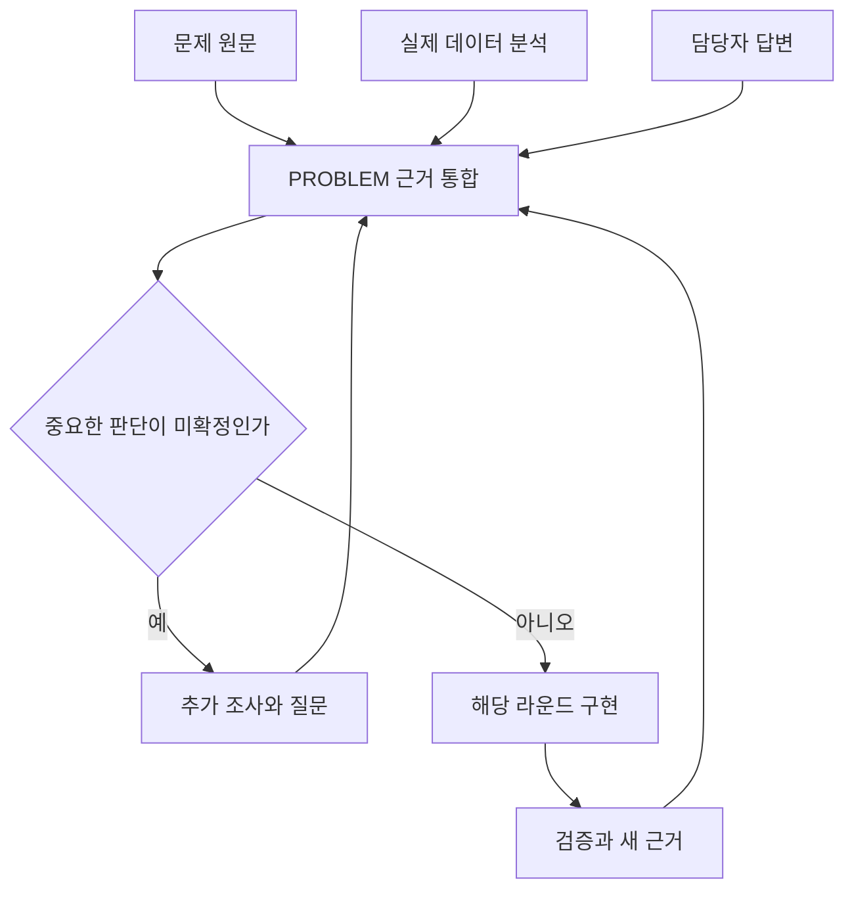

# 3시간 과제 실행 시나리오

이 문서는 참고용이다. 공통 규칙은 `AGENTS.md`, 상황별 요청문은 `START.md`를 따른다. 매 작업마다 이 문서 전체를 읽을 필요는 없다.

아래는 **품질 이슈 CSV를 읽고, 조건으로 조회하고, 조회 결과를 내보내는 가상 과제**다. 뒤에는 데이터 해석과 업무 판단이 필요한 확장 사례를 덧붙였다.
실제 과제의 요구사항·배점·검사 결과가 아니다. 시간 배분도 제안이며 공식 안내가 우선한다.
입력 선택·내보내기 방식은 실제 과제의 허용 범위를 따른다. 파일 선택창이나 외부 서비스 연결을 필수로 요구하지 않는다.

## 1. 시작: 과제 폴더에서 준비하기

문제와 시작 코드가 있는 과제 폴더에서 `README.md`의 ‘시작하기’ 절의 clone 명령을 실행한다. 이미 내려받았으면 기존 변경부터 확인한다. 하네스 폴더로 이동해서 제품을 만들지 않는다.

Codex 채팅에 전달한다.

```text
현재 과제 폴더에서 _harness/hsh-hackathon/AGENTS.md와
_harness/hsh-hackathon/START.md의 '처음 시작'을 적용해줘.
문제 원문·기존 코드·Git 변경·실행 환경을 확인하고 문제를 쉬운 말로 설명해줘.
실제 데이터 분석·담당자 질의의 근거를 docs/PROBLEM.md에 정리해줘.
반드시 지킬 조건 / 개선 목표 / 데이터 관측 / 설계 가정과 구현 전 미결정 판단을 구분해줘.
허용된 질의 채널이 없으면 질문안과 확인 대기로 남겨줘.
필수 흐름을 필요한 수의 라운드로 나누고 docs/PLAN.md와 첫 라운드 문서를 준비해줘.
기존 기록은 덮어쓰지 말고 같은 역할의 문서는 재사용해줘.
실제 실행·검사 방법, 가정과 차단 사항을 알려줘. 아직 구현은 시작하지 마.
```

별도 Python 하네스 실행은 없다. 제품이 Python을 사용한다면 제품 실행·검사에는 Python이 필요할 수 있다.
Codex가 파일을 저장했는지 확인하고 계획이 맞으면 다음 구현 요청으로 넘어간다.
아직 라운드가 없으면 PLAN의 라운드 전 인계에 상태를 남긴다. 기존에 허용한 작업은 반복 승인받지 않는다.

### PROBLEM을 처음 읽는 사람에게 보여줄 순서

가상 배경 예시: 공장 운영자는 생산라인마다 들어온 품질 문제를 살펴보고 점검 대상을 골라야 한다. 한 라인에서 신고가 많이 들어와도 생산량을 함께 보지 않으면 문제가 자주 생기는 곳인지 판단하기 어렵다. 이 사례에서 첫 목표는 운영자가 원하는 라인의 이슈를 찾아 목록으로 보는 것이다.

본문은 현장과 사람 → 어려움 → 해결할 문제 → 중요한 발견 → 핵심 조건 → 개선 목표 → 지금 필요한 판단 → 다음 행동 순서로 쓴다.
아래처럼 발견의 의미를 먼저 설명하고, 기술적인 근거는 하단이나 기존 분석 자료로 연결한다.

| 가상 예시의 표현 | 사용자가 이해할 설명 |
|---|---|
| L1 open 3건, L2 open 2건 | 이 예시에서는 L1의 미처리 이슈가 더 많습니다. 다만 생산량을 모르므로 불량률이 더 높다고 말할 수는 없습니다. |
| 동일 데이터 재적용·실패 롤백 | 새 데이터를 적용하지 못하면 이전 데이터를 유지합니다. 이것이 실제 과제 규칙인지 먼저 확인합니다. |
| 우선순위 인자 미확정 | 이슈가 많은 곳과 심각한 이슈가 있는 곳 중 어디를 먼저 점검할지 아직 정하지 못했습니다. |

첫 행의 'open=미처리'는 이 표현 예시를 위한 가정이다. 실제 과제에서는 상태의 업무 의미를 먼저 확인한다.
기술 용어는 필요한 때만 설명한다. 위 예시를 과제의 확정 조건·실제 관찰로 복사하지 않는다.

본문에 전체 통계·Git·설치 버전·도구 실패·모든 과거 답변을 붙이지 않는다.
정확한 규칙·예외·출처는 하단, 분석 수치의 재현 근거는 기존 분석 자료, 작업 상태와 실행 로그는 PLAN·라운드에서 확인한다.
답변을 받으면 현재 조건과 남은 질문을 갱신하고 변경 이유는 기존 기록에 남긴다. 매번 새 절을 덧붙여 문서를 길게 만들지 않는다.
처음 작성할 때와 길어졌을 때 `START.md`의 ‘PROBLEM을 쉽게 작성하고 정리하기’ 절을 적용한다.

### 라운드를 나누기 전에 최종 결과 한 조각 그리기

설명용 가상 예시다. 운영자가 ‘L1 · open’을 선택하면 다음과 같은 결과를 기대한다.

| 생산라인 | 선택한 상태 | 결과로 보일 이슈 |
|---|---|---|
| L1 | open | I001, I002, I004 (3행) |

조회 화면에는 세 이슈가 각각 한 행으로 나오고, 내보낸 파일에도 같은 세 ID가 들어간다. 이 작은 예시로 결과의 모양을 확인한 뒤 조사와 구현 계획을 세운다. 실제 제품 실행 후 R2에서는 조회 결과를, R3에서는 내보낸 내용을 대조한다. 담당자 답변에 따라 예시가 바뀌면 먼저 근거를 갱신한다.

### 구현 전 PROBLEM에서 확인할 것

1. 사용자·입력·처리·결과를 이해하고 정상 예시와 규칙 위반 예시를 구분한다.
2. 데이터의 한 행이 무엇을 뜻하는지, 열·기간·누락·중복·ID 연결에 문제가 있는지 확인한다.
3. 설계에 필요한 분석만 수행하고 관측 사실과 해석·원인 가설을 구분한다. 입력 버전·필터·분모·계산 방법을 남긴다.
4. 데이터만으로 알 수 없는 업무 의미는 담당자·시나리오 에이전트에 질문하고 실제 답변과 적용 범위를 기록한다.
5. 조건·목표·인자에 값·단위·근거·확정 상태를 붙인다. 중요한 미결정 판단은 의존하는 구현 전에 확인한다.

예를 들어 아래 R1의 7행 자료에서는 L1의 open이 3건, L2의 open이 2건이다.
이것은 가상 표의 상태별 건수이며 실제 과제 분석 결과가 아니다. 생산량과 표본 수집 기준이 없으므로 L1의 불량률이 높다고 단정할 수 없다.
단순 조회 과제라면 이처럼 짧게 정리하고 구현한다. 원인 분석·우선순위 결정까지 요구된다면 뒤의 확장 예시처럼 더 확인한다.



그림은 판단에 의존하는 작업의 흐름이다. 답변을 기다리는 동안 독립적인 데이터 검증·기본 실행 구성은 허용 범위에서 진행할 수 있다.
MD의 Mermaid 코드는 플러그인 없이 저장할 수 있지만 그림 표시는 뷰어 지원이 필요하다. 미지원 환경의 대안은 `prompts/ARCHITECTURE.md`을 따른다.

## 2. 시간표와 라운드 예시

아래 R1~R3는 이 가상 과제를 나눈 예시다. 실제 라운드 수는 과제 범위·의존성·남은 시간에 따라 정하며, 2개나 3개로 고정하지 않는다.

| 경과 시간 | 작업 | 확인할 결과 |
|---|---|---|
| 0~15분 | 문제·기존 환경 확인, 초기 분석·질의, PROBLEM·PLAN·R1 준비 | 조건·목표·미결정 판단·첫 흐름 구분 |
| 15~40분 | R1: CSV 선택 → 읽기 → 목록 표시 | 실제 제품 진입점에서 첫 전체 흐름 |
| 40~80분 | R2: 생산라인·상태 조건 조회 | R1 입력과 연결된 조회 결과 |
| 80~115분 | R3: 조회 결과 다운로드 | 현재 조회와 같은 내용의 실제 파일 |
| 115~135분 | 선택 기능 중단, 필수 누락·오류 수정 | 차트 등 선택 기능은 보류, 필수 동작 보완 |
| 135~150분 | 전체 검증 | 입력 → 조회 → 다운로드와 중요한 실패 사례 |
| 150~160분 | REVIEW 복습 | 내가 데이터 흐름·선택 이유·한계를 설명 |
| 160~175분 | 제출 준비 점검 | 실행법·필수 파일·원본·개발 도구 제외 점검 |
| 175~180분 | 예상 밖 문제에 대비한 여유 | 남은 문제 확인, 플랫폼 제출 버튼은 사용자 담당 |

이 시간표는 단순 조회 과제의 예시다. 업무 해석·최적화가 중요한 과제는 조사 시간을 조정하되 독립 작업과 마무리 시간을 함께 확보한다.
필수 기능을 임의로 빼서 시간을 맞추지 않는다. 범위가 크면 선택 기능부터 줄인다.

| 필요한 경우 | 언제 읽는가 | 실제로 확인할 것 |
|---|---|---|
| 사용자 화면 | 첫 R1 화면 전, 중요한 흐름 변경 전, 화면 구현 후 `prompts/UI.md` | 배치·주요 동작·오류·결과 없음·이전 결과의 상태 |
| 복잡한 구조 설명 | 설계 전과 구조 변경 후 `prompts/ARCHITECTURE.md` | 네 가지 도식·쉬운 예시·실제 코드와의 일치 |
| Docker 실행 요구 | 초기 설계와 첫 실행 흐름부터 `prompts/DOCKER_READY.md` | 빌드·기동, DB·보존이 요구되면 빈 DB 준비·저장 데이터 보존 |

해당하지 않는 항목은 이유와 함께 생략한다. 요청문을 읽었다는 사실과 실제 구현·검증 완료를 구분한다.
Compose는 프로그램·DB 등의 실행 설정을 함께 관리하는 도구다. 필요한 경우에만 구성하고, 실제 외부 배포는 수행하지 않는다.
같은 접근이 두 번 실패하거나 약 10분 동안 진전이 없으면 원인과 대안을 다시 정리한다.

## 3. R1 구현과 확인

가상 검사 입력은 다음 7행이다. 이는 설명을 위한 테스트 자료이며 제공 원본을 대체하지 않는다.

| 이슈 ID | 생산라인 | 상태 |
|---|---|---|
| I001 | L1 | open |
| I002 | L1 | open |
| I003 | L2 | open |
| I004 | L1 | open |
| I005 | L1 | closed |
| I006 | L2 | closed |
| I007 | L2 | open |

- R1 기능 01: CSV를 읽어 목록 표시.
- R1 검사 01: 위 입력의 목록이 7행인지 확인.
- R1 검사 02: 필수 열 누락 시 오류를 표시하고 잘못된 입력을 성공으로 표시하지 않는지 확인.
- R1 대화 01: 잘못된 데이터 적용을 요청했을 때 기존 결과를 유지할지 지울지 결정. 원문에 규칙이 있으면 우선 따르고, 규칙이 없을 때만 선택 논점으로 남긴다.
- 첫 화면 구현 전 UI 요청문으로 입력·검증·오류·표시 상태의 배치안을 정하고, 중요한 미결정 판단이 있는지 확인한다.

계획을 확인한 뒤 Codex에 전달한다.

```text
PROBLEM의 관련 조건과 PLAN, 현재 라운드 문서를 읽고 R1의 계획 범위에서 구현을 시작해줘.
화면을 만들기 전에 UI 요청문을 적용하고, 중요한 미결정 판단에 의존하는 작업만 보류해줘.
최소 기능을 실제 제품 진입점에 연결하고 독립적으로 정한 기대 결과로 검사해줘.
화면 확인이 필요하면 실행 명령·작업 경로·미리보기 포트·입력·조작·기대 결과를 알려줘.
실행 근거와 인계는 R1 문서에, 구현·검사·사용자 확인 요약은 PLAN에 저장해줘.
새 업무 기준·분석 근거는 PROBLEM에 기록하고 실제 코드와 함께 관련 항목을 연결해줘.
입력이 어떤 실제 파일과 함수를 거쳐 결과가 되는지 짧게 설명해줘.
```

사용자는 안내한 화면을 직접 조작한다. 문제가 있으면 관찰한 내용을 말한다.

```text
R1 기능 01 피드백이야. 정상 데이터 뒤에 잘못된 데이터를 선택하니 이전 목록이 새 결과처럼 보여.
이 가상 과제에는 실패 시 유지 규칙이 없으므로, 잘못된 입력에서는 오류와 함께 이전 목록을 지우도록 해줘.
이 결정을 R1 대화 01에 남기고, 수정 후 정상 입력과 실패 입력의 연결 동작을 다시 검사해줘.
내가 관찰한 결과와 네가 직접 실행한 결과를 구분해서 기록해줘.
```

이는 가상 피드백 예시다. 실제 관찰하지 않은 내용을 검사 결과로 복사하지 않는다.
실제 과제에서 기존 결과 유지가 의무라면 지우지 않고, 이전 결과임을 표시한다. 업무 기준 변경은 PROBLEM에 연결한다.

## 4. R2·R3로 확장하기

| 라운드 | 기능 | 독립적인 기대 결과 | 앞 라운드와 연결 확인 |
|---|---|---|---|
| R2 | 생산라인·상태 조회 | 위 입력에서 L1 + open은 I001·I002·I004의 3행 | CSV 재선택 후 조회가 새 입력에 적용되는지 |
| R3 | 조회 결과 다운로드 | 같은 조건이면 내려받은 파일도 해당 3행 | 화면 조건·파일 내용 일치, 빈 결과 처리 |

아래는 이 가상 과제의 R2 요청문이다. 다른 과제에서는 라운드 번호와 함께 목표·선행 기능·검사 내용을 실제 계획에 맞춰 바꾼다.

```text
PLAN의 R2를 진행해줘. R1의 현재 결과와 관련 코드만 확인하고 R2 문서를 준비해줘.
조회 기능을 기존 흐름에 연결하고, 기대한 행의 ID와 개수를 확인해줘.
R1의 CSV 입력과 오류 처리가 유지되는지도 확인해줘.
각 라운드의 상세 근거와 PLAN 요약을 갱신하고 다음 행동을 알려줘.
```

R3에서는 다운로드 기능에 맞는 요청문을 사용한다.

```text
PLAN의 R3를 진행해줘. R1의 입력과 R2의 조회 결과·관련 코드 및 검사 근거를 확인하고 R3 문서를 준비해줘.
현재 조회 조건에 해당하는 행을 실제 파일로 내려받는 기능을 연결해줘.
내려받은 파일을 열어 행의 ID·개수·필수 열이 독립 기대 결과와 일치하는지 확인해줘.
화면의 조회 결과와 파일 내용의 일치, 빈 결과 처리, R1·R2 흐름의 유지 여부도 확인해줘.
실제 결과와 미확인은 R3에, 상태 요약과 다음 행동은 PLAN에 갱신해줘.
```

새 라운드마다 제품 전체를 복사하거나 다시 만들지 않는다. 차트 같은 선택 기능을 보류했다면 이유를 현재 라운드의 결정에 남기고 PLAN의 범위를 갱신한다.

## 5. 업무 판단이 필요한 과제의 확장 예시

같은 데이터로 조회를 넘어 '어느 생산라인을 먼저 점검할지 추천'하라는 요구가 추가되었다고 가정한다.
이는 설명용 가정이며 실제 과제의 요구사항이나 담당자 답변이 아니다.

| 관측·미확정 논점 | 해야 할 분석·질문 | 확정 전에 해서는 안 되는 판단 |
|---|---|---|
| 예시 표의 L1 open 3건, L2 open 2건 | 한 행이 고유 이슈인지 이력인지, 비교 기간·생산량·중복 여부 확인 | 건수가 많으므로 불량률도 높다고 단정 |
| open과 closed의 업무상 의미 | open은 미조치 상태인지, closed는 재발 가능성과 무관한지 담당자에게 확인 | 상태명만 보고 추천 대상·제외 대상을 확정 |
| 점검 우선순위의 목적 | 심각도·미처리 기간·건수 중 필요한 지표와 우선순위 확인 | 임의 가중치를 업무 정답으로 취급 |
| 필요한 열·분모가 없는 경우 | 추가 제공 여부, 허용되는 추정·대체 지표와 한계 확인 | 없는 수치나 담당자 답변을 생성 |

질문할 때는 '어떻게 구현할까요?'만 묻지 않고 '건수 기준과 비율 기준은 다른 대상을 우선할 수 있는데 업무 목적과 비교 분모는 무엇인가요?'처럼 발견 배경과 영향을 설명한다.
답변이 없으면 미확정으로 남긴다. 이미 명확한 CSV 검증·조회·기본 화면 작업은 계속할 수 있다.

진행 순서:

1. 원문과 실제 입력을 PROBLEM에 정리하고 관련 방법의 조사가 필요하면 과제에서 허용된 범위에서 수행한다.
2. 담당자 답변과 데이터 관측을 구분해 기록하고 반드시 지킬 조건·개선 목표·설계 가정을 정한다.
3. 계산 인자에 값·단위·적용 범위·출처·확정 상태를 연결한다. 중요한 선택은 작은 예시·선택지·추천 이유로 설명한다.
4. 확정된 조건을 만족하는 단순 기본안을 구현하고 독립 예제로 검증한다.
5. 같은 입력과 평가 지표로 대안을 비교한다. 의무 조건을 위반하며 목표 점수를 높이지 않는다.
6. 새로운 근거나 데이터 변경이 있으면 PROBLEM과 관련 구조 설명·라운드·검사를 갱신한다. 최적성의 근거가 없으면 최적해라고 단정하지 않는다.

이 확장 절차는 분석·판단이 필요한 부분에만 적용한다. 간단한 목록 조회에 불필요한 최적화나 담당자 승인을 붙이지 않는다.

## 6. 중간마다 전체 상황 보기

**과제 폴더의 `docs/PLAN.md`가 전체 진행상황을 보는 파일이다.** 하네스에는 `templates/PLAN.md`이 있고, 실제 과제 시작 시 Codex가 내용을 채운다.

- 맨 위에는 현장의 문제 한 문장, 해결 순서, 현재 라운드와 필요한 판단을 짧은 불릿으로 적는다.
- 문제 기준: PROBLEM의 실제 위치와 핵심 조건·목표·미결정 사항 요약. PROBLEM 본문은 쉬운 현재 요약이며 정확한 조건은 하단, 상세 통계는 연결된 분석 자료에서 확인.
- 라운드 표: 구현 연결·검사·사용자 확인을 따로 표시하고 상세 문서로 연결.
- 마무리: REVIEW 위치로 이동하여 전체 검증·복습·제출 준비 상태 확인.

라운드 종료, 중요한 변경·실패 수정 후, 대화창 전환 전후에 갱신한다. 매 대화마다 별도 보고서를 만들지 않는다.

```text
_harness/hsh-hackathon/START.md의 '전체 진행상황 점검'을 적용해줘.
PLAN을 현재 근거에 맞게 갱신하고, 끝난 범위·남은 필수 작업·차단·내 확인이 필요한 항목·바로 다음 행동을 알려줘.
```

자동 대시보드나 실시간 타이머가 아니다. Codex가 저장한 마지막 시점의 요약이며, 기록만 갱신했다고 제품 검사를 새로 통과한 것은 아니다.
라운드 수를 세어 제품 완성률로 표시하지 않는다. 작은 라운드 하나와 큰 필수 기능 하나의 작업량은 다르다.

## 7. 대화창을 바꿀 때

1. 현재 창에서 `START.md`의 ‘대화창 바꾸기 전’ 절 요청문을 사용한다.
2. PROBLEM의 관련 조건·가정·미결정 사항과 PLAN·현재 라운드 인계가 저장됐는지, 실제 경로와 재개 요청문을 확인한다.
3. 같은 과제 폴더의 새 창에서 `START.md`의 ‘새 대화창에서 이어가기’ 절를 사용한다.
4. Codex는 관련 문제 근거·입력 버전과 기록을 실제 Git·파일·서버와 대조한 뒤 허용된 작업을 이어간다.

핸드오프는 다음 세션이 이어갈 요약이다. 대화 전문을 복사하는 기능이 아니며, 별도 인계 문서를 늘리지 않는다.
작업 환경 자체가 달라지면 기록뿐 아니라 실제 코드·필요 데이터에도 접근할 수 있어야 한다.
중요한 결정·라운드 종료·긴 오류 조사 후에도 인계를 갱신한다. 자동 압축 알림은 이 하네스에 포함되어 있지 않으며, 직전 알림에만 의존해 요약을 미루지 않는다.

## 8. 마무리

`START.md`의 ‘마무리: 전체 검증 → REVIEW 복습 → 제출 준비 점검’ 절을 사용한다.

1. **전체 검증:** 현재 제품에서 CSV → 조회 → 다운로드를 확인하고 중요한 실패 사례와 필수 누락을 검사한다.
2. **REVIEW 복습:** 내가 “입력이 어디서 들어와 어떤 처리를 거치는지, 왜 이 구조인지, 한계가 무엇인지” 설명한다. 설명 대기 중에도 독립적인 준비 점검은 진행한다.
3. **제출 준비 점검:** 공식 안내에 맞는 실행법·필수 파일·원본 보존·개발용 기능 제외·민감정보를 점검한다. 실행 안내는 과제 지정 문서 또는 기존 프로젝트 문서를 활용하고 특정 파일명을 강제하지 않는다.

UI가 있으면 실제 화면·상태 전환 근거를, Docker가 요구되면 빌드·기동 근거를, DB·보존이 요구되면 빈 DB 준비·데이터 보존 근거도 확인한다.
구조 설명이 있으면 현재 코드·설정과 일치하는지 확인하고 조건의 근거·가정·선택 이유를 사용자 자신의 말로 설명해 본다.
실제 외부 배포는 수행하지 않는다. 제공된 개발 환경 안에서 확인한 것과 확인하지 못한 것을 구분한다.

상세 결과는 `docs/REVIEW.md`에 기록한다. 검사 통과, 사용자 이해 확인, 준비 상태는 서로 별개다.
수정이 생기면 영향받은 검사와 준비 항목을 다시 확인한다. 미실행을 완료로 표시하지 않는다.

**과제 작업 중 git push 및 다른 방법을 통한 외부 저장소 업로드는 금지한다.**
하네스는 제출 준비 점검까지만 맡는다. 플랫폼 제출 버튼은 사용자가 누르며, Codex가 제출 결과나 접수 기록을 추적하지 않는다.
